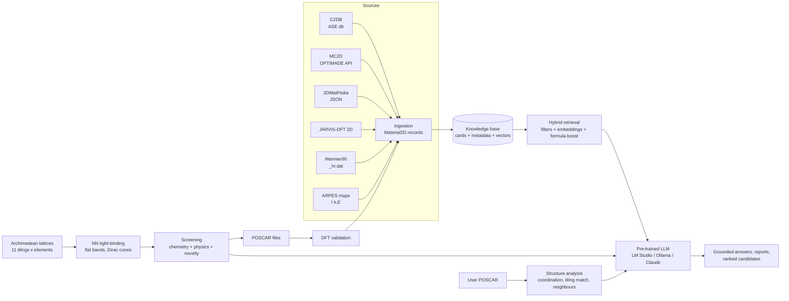
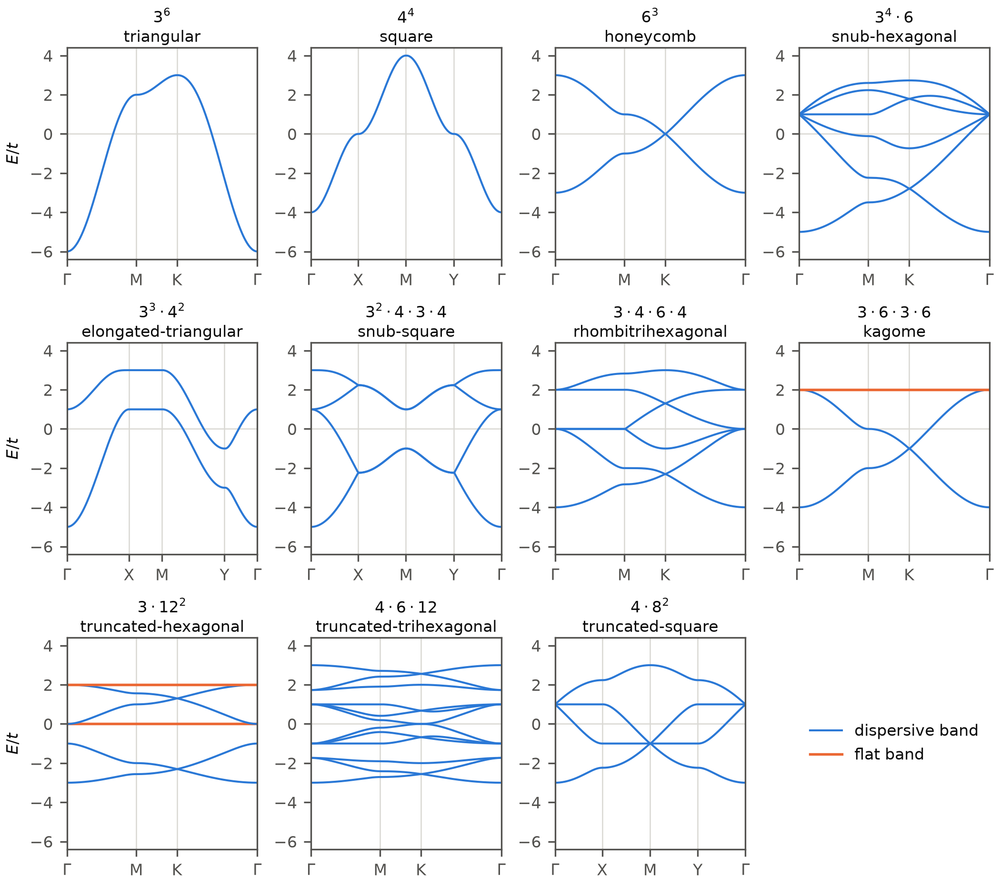

# LLMatter2D

[](https://github.com/levsan13/LLMatter2D/actions/workflows/ci.yml)
[](LICENSE)
[](pyproject.toml)
[](https://doi.org/10.5281/zenodo.23779294)

**Retrieval-augmented LLM for the analysis and discovery of two-dimensional materials.**

LLMatter2D feeds a pre-trained large language model, run locally through
[LM Studio](https://lmstudio.ai), with curated, citable data on 2D materials (DFT
electronic structure, tight-binding/Wannier hoppings, geometry, ARPES observables)
through a retrieval-augmented generation (RAG) stack. On top of it, a
generator built on the eleven **Archimedean lattices** proposes new 2D materials, screens
them with tight-binding physics and asks the LLM to critique them against known analogues.

> **Resumo (pt-BR).** O LLMatter2D é uma pilha RAG que abastece uma LLM pré-treinada,
> executada localmente via LM Studio, com dados de materiais bidimensionais: propriedades eletrônicas de DFT (C2DB, MC2D,
> 2DMatPedia, JARVIS), hoppings tight-binding (Wannier90), geometria e observáveis de ARPES
> (velocidade de Fermi, massa efetiva, desdobramento spin-órbita). Com isso a LLM analisa
> materiais 2D novos citando a origem de cada número, e um gerador baseado nas 11 redes de
> Arquimedes propõe candidatos a novos materiais, triados por tight-binding (bandas planas,
> cones de Dirac) e revisados pela LLM, com arquivos POSCAR prontos para validação por DFT.

Status: **v0.1, research prototype.** The data model, connectors, RAG stack, LLM backends,
Archimedean generator and CLI work and are tested; large-scale ingestion, evaluation and
DFT automation are on the [roadmap](docs/roadmap.md).

---

## Why

General-purpose LLMs know a lot about graphene and MoS2, but they hallucinate numbers,
mix functionals (PBE vs HSE vs experiment) and know little about the thousands of
less-famous monolayers in computational databases. LLMatter2D keeps the LLM grounded:

* **Numbers come from records, not from model weights.** Every value carries its method
  and source, and the model is instructed to cite record ids (`[c2db:...]`, `[mc2d:...]`).
* **Hybrid retrieval.** Numerical constraints (band gap window, magnetism, elements,
  ARPES availability) are metadata filters; embeddings only rank what passes the filters.
* **Physics in the loop.** Tight-binding features (Dirac crossings, flat bands, quadratic
  touchings) are computed, not guessed, and handed to the LLM as context.
* **Closed discovery loop.** Candidates are exported as POSCAR files; once validated by DFT
  they are ingested back as ordinary records.

## Architecture



More detail in [docs/architecture.md](docs/architecture.md).

## Installation

```bash
git clone https://github.com/levsan13/LLMatter2D.git
cd LLMatter2D
pip install -e ".[dev]"            # core: numpy + pydantic only (LM Studio needs nothing else)
pip install -e ".[all]"            # + sentence-transformers, ASE, jarvis-tools, h5py, anthropic
```

Python 3.10+.

### LLM: a pre-trained model in LM Studio (default)

1. Install [LM Studio](https://lmstudio.ai) and download an instruction-tuned model
   (e.g. Qwen2.5-7B/14B-Instruct, Llama-3.1-8B-Instruct, Mistral-Small).
2. Load it with a **context length of at least 8k tokens** (RAG prompts carry several records).
3. Start the local server: *Developer* tab -> *Start Server*, or `lms server start`
   (default `http://localhost:1234`).

LLMatter2D talks to LM Studio's OpenAI-compatible endpoint (`/v1/chat/completions`) and
uses the first loaded chat model unless told otherwise:

| Setting | How |
|---|---|
| model | `--llm lmstudio:<model-id>` or `LMSTUDIO_MODEL` |
| server | `LMSTUDIO_HOST` (default `http://localhost:1234`) |
| API key (if enabled in LM Studio) | `LMSTUDIO_API_KEY` |
| another default backend | `LLMATTER2D_LLM=ollama:<model>` / `claude` / `offline` |

`<think>...</think>` blocks from reasoning models are removed from the answers.

## Quick start

```bash
# 1. Pull data (MC2D is public via OPTIMADE; C2DB and 2DMatPedia are local files)
llmatter2d ingest mc2d -o data/raw/mc2d.jsonl
llmatter2d ingest c2db --path c2db.db -o data/raw/c2db.jsonl
llmatter2d ingest 2dmatpedia --path db.json -o data/raw/2dmatpedia.jsonl

# 2. Build the knowledge base (add --embedder st:BAAI/bge-small-en-v1.5 for dense vectors)
llmatter2d index data/raw/*.jsonl --seed -o kb

# 3. Ask grounded questions (LM Studio server running with a model loaded)
llmatter2d ask "Which monolayers have a direct gap between 1.5 and 2 eV?" --gap-min 1.5 --gap-max 2
llmatter2d ask "Compare the spin-orbit splitting at K in MoS2 and WSe2" --require-arpes
llmatter2d ask "Qual o gap do MoS2 segundo cada método?" --llm lmstudio:qwen2.5-14b-instruct

# 4. Analyse a new structure
llmatter2d analyze my_monolayer.vasp

# 5. Explore the Archimedean lattices and propose new materials
llmatter2d archimedean                      # list the 11 tilings
llmatter2d archimedean kagome --bands kagome_bands.csv --species Fe --bond 2.5
llmatter2d predict --elements B C N Si --top 10 -o candidates
```

Without a knowledge base or a running LLM everything still runs: the built-in seed set of
well-known monolayers is used and `--llm offline` shows exactly what would be sent to the model.

### Python API

```python
from llmatter2d.rag import KnowledgeBase, RAGPipeline, Filters
from llmatter2d.llm import get_llm

kb = KnowledgeBase.from_seed()                 # or KnowledgeBase.load("kb")
rag = RAGPipeline(kb, get_llm("lmstudio"))     # first model loaded in LM Studio
answer = rag.ask("Which Xenes are quantum spin Hall insulators and how large is the SOC gap?",
                 filters=Filters(tags_any=["xene"]))
print(answer.text, answer.sources)
```

```python
from llmatter2d.lattices import archimedean_lattice, analyze_bands
from llmatter2d.predict import enumerate_candidates, score_candidates

print(analyze_bands(archimedean_lattice("3.12^2"), t=2.7).summary())  # two flat bands
cands = score_candidates(enumerate_candidates(["B", "N"]), kb=kb)
print(cands[0].describe())
```

See also [examples/](examples).

## Archimedean lattices



Nearest-neighbour tight-binding bands of the eleven Archimedean tilings (flat bands in
orange). The tilings themselves are drawn in
[paper/figures/archimedean_tilings.png](paper/figures/archimedean_tilings.png) and
summarised in [paper/tables/archimedean.md](paper/tables/archimedean.md).

## Evaluation

`llmatter2d benchmark` measures what the RAG layer adds to a pre-trained model:

```bash
llmatter2d benchmark benchmarks/seed_questions.jsonl                         # retrieval only
llmatter2d benchmark benchmarks/seed_questions.jsonl --mode rag closed_book  # with the LLM
```

* **retrieval**: recall@k and mean reciprocal rank of the records that hold the answer;
* **answers**: unit-aware grading of numerical answers (eV/meV, angstrom/nm, m/s, K) and
  keyword grading of textual ones, for the same model with retrieved context (`rag`) and
  without it (`closed_book`);
* **citations**: fraction of cited record ids that were retrieved (valid) and that hold
  the answer (precise).

Two question sets ship with the repository: 25 curated questions
(`benchmarks/seed_questions.jsonl`) and 300 questions generated from MC2D and JARVIS-DFT
records (`benchmarks/db_questions.jsonl`). On the 3799-record knowledge base built from
MC2D, JARVIS-2D and the seed set, the record holding the answer is ranked first for
99.7-100% of the database questions with the exact formula match enabled, against 25%
(lexical) and 74% (dense) without it; full table in
[paper/tables/retrieval.md](paper/tables/retrieval.md).

## Reproducibility and publication

[paper/](paper) regenerates every figure, table and benchmark result
(`python paper/reproduce.py`); [paper/outline.md](paper/outline.md) holds the manuscript
plan and the choice of journal.

## What is inside

| Module | Content |
|---|---|
| `llmatter2d.schema` | `Material2D`: structure, band gaps (with method), magnetism, stability, tight-binding models, ARPES features, provenance |
| `llmatter2d.ingest` | OPTIMADE client (MC2D), C2DB (ASE db), 2DMatPedia (JSON), JARVIS-DFT 2D, Wannier90 `_hr.dat` reader/writer, ARPES feature extraction (MDC/EDC peaks, Fermi velocity, effective mass), curated seed set |
| `llmatter2d.rag` | material cards, hashing and sentence-transformer embedders, knowledge base with metadata filters and persistence, RAG pipeline |
| `llmatter2d.llm` | LM Studio backend (default; local pre-trained models through the OpenAI-compatible server), Ollama backend, optional Claude backend (Anthropic SDK), offline backend; task prompts (`qa`, `analyze`, `predict`) |
| `llmatter2d.lattices` | the 11 Archimedean tilings, bipartite decoration, NN tight-binding, band structures, flat-band and Dirac-crossing detection, POSCAR I/O |
| `llmatter2d.predict` | candidate enumeration, heuristic screening, novelty against the knowledge base, LLM review, export for DFT |
| `llmatter2d.analysis` | descriptors of a user structure, Archimedean-tiling match of the projected network, structural neighbours |
| `llmatter2d.evaluation` | benchmark runner: retrieval metrics, unit-aware answer grading, citation metrics, RAG vs closed-book |

## Data sources and licensing

The databases are **not** redistributed here; each one has its own terms and citation
requests. See [docs/data_sources.md](docs/data_sources.md). The seed file shipped with the
package contains a handful of approximate literature values for demos and tests only.

## Prior art and naming

A search (October 2026) found no project or paper named *LLMatter2D*. The closest names are
an unrelated VR/LLM repository called "LLMatter" and the materials LLMs LLaMat,
LLMatDesign and MatterChat. Related work and how LLMatter2D differs:
[docs/prior_art.md](docs/prior_art.md).

## Citing

If you use LLMatter2D, please cite the archived software,
[doi:10.5281/zenodo.23779294](https://doi.org/10.5281/zenodo.23779294) (all versions; see
[CITATION.cff](CITATION.cff)), together with the databases and papers behind the data you used.

## Contributing

Issues and pull requests are welcome; see [CONTRIBUTING.md](CONTRIBUTING.md) and the
[changelog](CHANGELOG.md).

## License

MIT, see [LICENSE](LICENSE).
